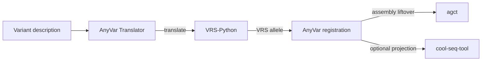
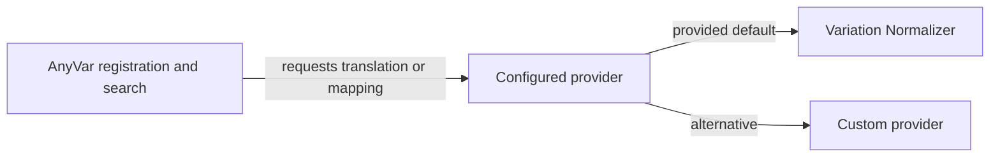

# AnyVar-ADR-001: Delegate variation translation, liftover, and projection to a configurable provider

**Date:** 2026-11-27

**Status:** Proposed

**Description:** During registration and search, AnyVar will use the Variation Normalizer by default to translate variant descriptions, lift alleles between assemblies, and project alleles onto the selected transcript. Teams may also supply their own provider.

---

## Context

**How AnyVar registers a description today**



**The problems**

- AnyVar and the Variation Normalizer both use Cool-Seq-Tool's longest-compatible-transcript fallback. They call it through different entry points.
- REST operators can enable the built-in projector by installing Cool-Seq-Tool and setting `ANYVAR_ENABLE_PROJECTION=true` before startup. Python callers can supply their own projector. Both use AnyVar's built-in liftover for registration and categorical search.

**Alternatives considered**

1. Keep AnyVar's mapping code. This preserves its dependencies and behavior but leaves two projects maintaining the same fallback.
2. Let callers choose a translator and require the Variation Normalizer for mapping. This fixes the liftover and transcript-selection policies for all callers.
3. Let one provider handle translation and mapping (proposed). AnyVar and standalone clients can share the default policies, and callers can override either mapping operation.

---

## Decision

AnyVar accepts existing GKM variation objects directly. It validates, stores, and indexes supported objects and their mappings. When registration or search needs translation or mapping, it calls the configured provider. The default is `VariationNormalizerTranslator`.

AnyVar rejects unsupported outputs and reports unresolved candidates without registering them. It records the input, warnings, policy choices, and provider and reference data versions outside identity-defining fields.

Registration keeps the input allele and every successful mapping if a later step fails. Categorical search returns any matches and reports incomplete searches, even when no matches are found.

Target the next major release. Switch the default after comparing allele IDs, stored mappings, and search results with current AnyVar behavior and documenting any intentional differences.

---

## Consequences

### Expected benefits

- Standalone clients can lift or project an allele without registering it. Given the same allele, policy, software, and reference data, they should get the same lifted allele and transcript as AnyVar.
- Teams can override liftover, projection, or both.

### Costs

- Teams who use the default provider must keep Variation Normalizer, Gene Normalizer, and their reference data compatible, even when running AnyVar in Docker.

### Risks

**Mapping differences.** Both projects already use agct for liftover and Cool-Seq-Tool for transcript selection. Delegating mapping policy to Variation Normalizer can still change which mappings AnyVar accepts. For example, registration already requires an unambiguous round trip, while categorical search uses the forward lift alone. Applying the registration rule to search can exclude matches even with identical tools and reference data.

Before switching providers, compare registration and search results for ambiguous lifts, failed round trips, and transcript projections from both original and lifted alleles. Repeat these checks when a provider release changes mapping policy. Document intentional differences and decide whether stored mappings need reprocessing.

**Dependency failures.** Registration could fail if Gene Normalizer is unavailable or data versions are incompatible.

Document Docker setup and tested software and data versions. Verify that the adapter reports an unavailable dependency as a provider failure.

Test whether the Universal Transcript Archive (UTA) can handle gene and transcript lookups when callers omit gene annotations (aka see if we can make Gene Normalizer optional in Variation Normalizer). Compare allele IDs and transcript choices, and identify inputs that still need Gene Normalizer for interpretation.

---

## References

- [AnyVar](https://github.com/ga4gh/anyvar)
- [Variation Normalizer](https://github.com/cancervariants/variation-normalization)

---

## Additional Information

### Proposed provider interface



Example of what this could look like:

```python
from abc import ABC, abstractmethod
from dataclasses import dataclass
from typing import Literal


@dataclass(frozen=True)
class MappingResult:
    """Outcome of one liftover request."""

    status: Literal["success", "invalid", "unsupported", "ambiguous", "inapplicable", "failed"]
    variations: tuple["SupportedVariation", ...] = ()
    mappings: tuple["VariationMapping", ...] = ()
    messages: tuple[str, ...] = ()

    @classmethod
    def unsupported(cls, operation: str) -> "MappingResult":
        """Report that the provider does not implement the requested operation."""
        return cls(status="unsupported", messages=(f"Provider does not support {operation}.",))


@dataclass(frozen=True)
class UnsupportedProjection:
    message: str


class Translator(ABC):
    """Translate descriptions, resolve sequence IDs, and map variation objects."""

    dp: "_DataProxy"  # Existing VRS data proxy used by VCF annotation and import

    # Existing method with a revised return type
    @abstractmethod
    def translate_variation(self, var: str, **kwargs) -> "TranslationResult":
        """Translate a variant description into candidate variation objects."""

    # Existing method
    @abstractmethod
    def translate_allele(self, var: str) -> "SupportedVrsVariation | None":
        """Translate an allele description into a normalized VRS object."""

    # Existing method
    @abstractmethod
    def get_sequence_id(self, accession_id: str) -> str:
        """Resolve a reference accession to its GA4GH sequence identifier."""

    # New method
    def liftover_allele(self, allele: "Allele", target_assembly: str) -> "MappingResult":
        """Return the lifted allele and its mapping after an unambiguous round trip."""
        return MappingResult.unsupported("liftover_allele")

    # New method
    def project_variation(self, variation: "SupportedVariation") -> "ProjectionResults | UnsupportedProjection":
        """Return transcript or protein projections and their mappings to the input."""
        return UnsupportedProjection("Provider does not support project_variation.")
```
